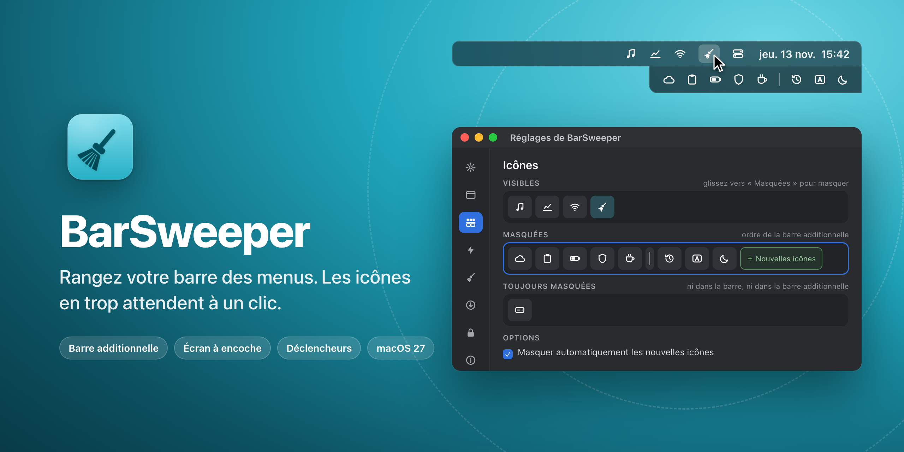
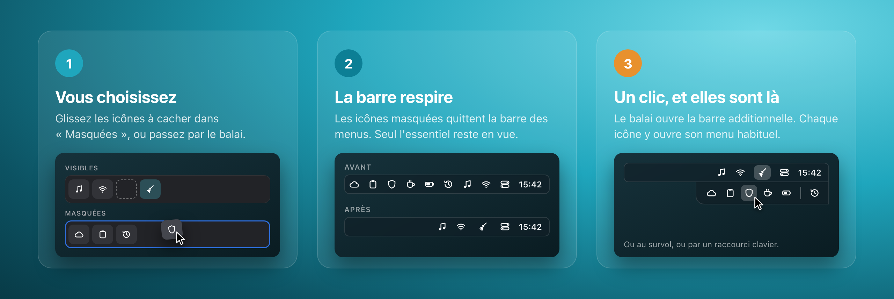
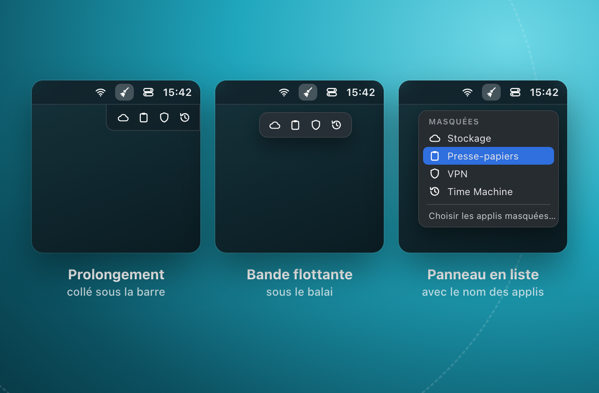
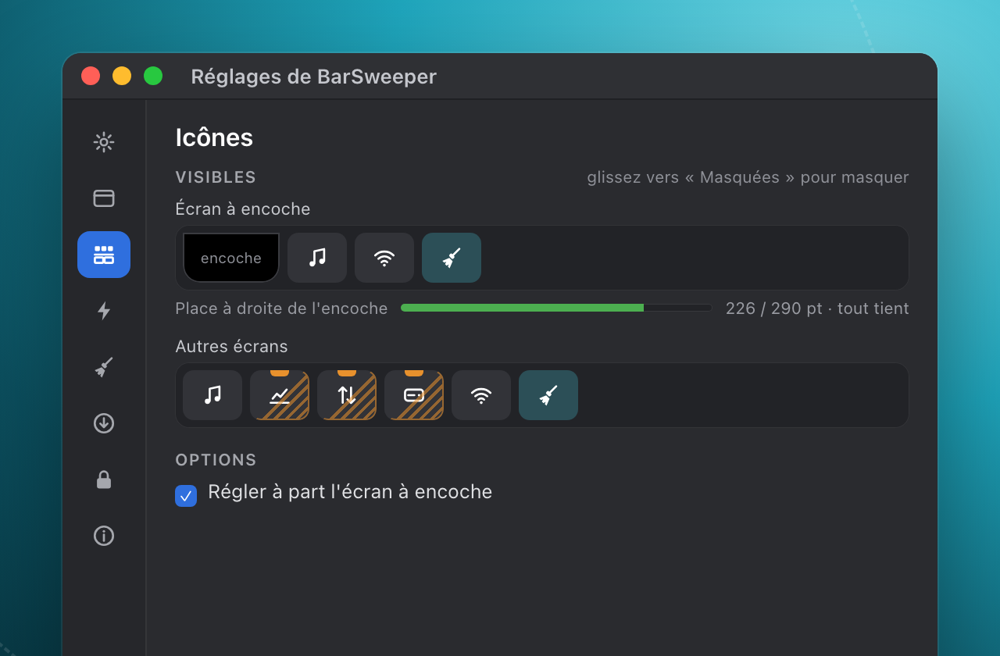
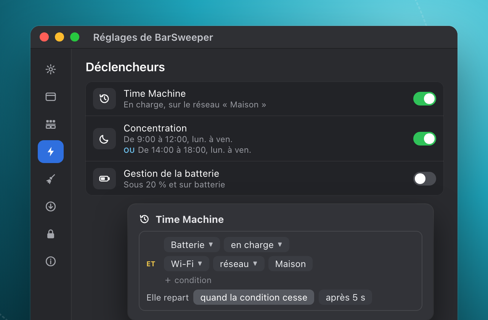
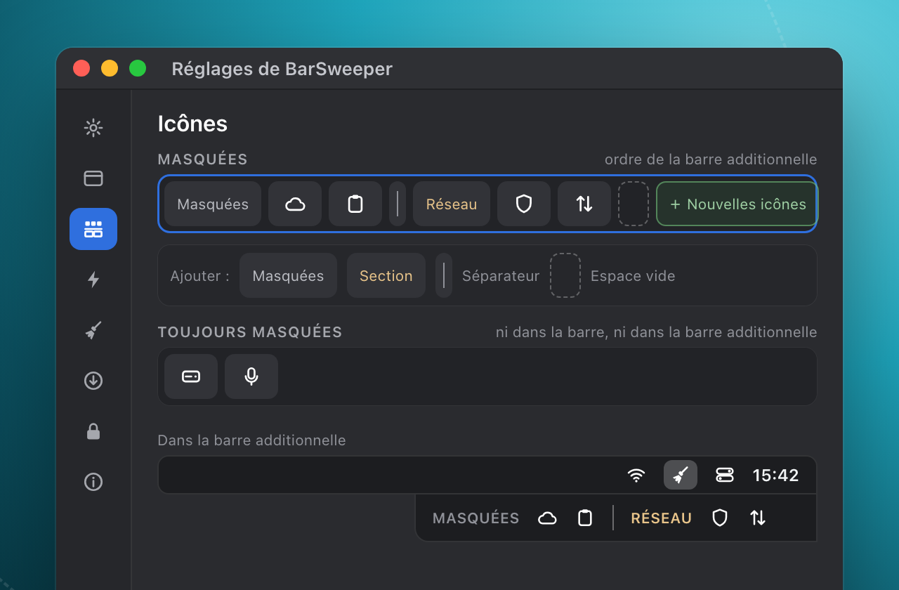

   
  macOS 27 · Mac à puce Apple · mises à jour signées

La barre des menus se remplit vite : une icône par appli, plus celles de macOS. Sur un MacBook,
l'encoche en cache une partie. BarSweeper vous laisse choisir celles qui restent en vue. Les autres
attendent dans une barre additionnelle, à un clic du balai.

## Comment ça marche

Une icône masquée n'est pas désactivée : son appli continue de tourner. Depuis la barre
additionnelle, un clic ouvre son menu comme si elle était restée dans la barre, et le clic droit
lui est transmis aussi. Pas de compte, pas de serveur : tout se passe sur votre Mac.

## Ce qu'il sait faire

<table>
<tr>
<td width="50%"> <b>Une barre additionnelle à votre goût</b> Collée sous la barre, en bande flottante ou en panneau avec le nom des applis. Elle s'ouvre au clic, au survol ou par un raccourci, et se referme seule si vous le souhaitez. Plusieurs styles : comme la barre des menus, verre, couleur unie…</td>
<td width="50%"> <b>L'écran à encoche réglé à part</b> Sur un MacBook, gardez moins d'icônes à droite de l'encoche et toutes les autres sur votre écran externe. Une jauge mesure la place qui reste. BarSweeper applique le bon jeu quand vous changez d'écran.</td>
</tr>
<tr>
<td width="50%"> <b>Des icônes qui reviennent au bon moment</b> Une icône masquée revient dans la barre selon la batterie, l'heure, le réseau Wi-Fi ou le lieu, puis repart quand la condition cesse. Plusieurs conditions peuvent se combiner.</td>
<td width="50%"> <b>Rangé comme vous l'entendez</b> Glissez les icônes entre « Visibles », « Masquées » et « Toujours masquées ». Ajoutez des sections, des séparateurs, des espaces. Les nouvelles icônes peuvent se ranger d'office avec les masquées.</td>
</tr>
</table>

Et aussi :

- les icônes de macOS : modules du Centre de contrôle, Time Machine, Siri, Saisie de texte… ;
- l'ordre des icônes visibles se change par glisser-déposer, en direct dans la vraie barre ;
- plusieurs écrans, ouverture à la session, icône du balai au choix (ou votre propre image) ;
- un volet Entretien pour retirer les entrées périmées de « Autoriser dans la barre des menus » ;
- quand vous quittez BarSweeper, chaque icône retrouve l'état où il l'avait trouvée.

## Installer

1. Téléchargez `BarSweeper-<version>.dmg` dans les
   [Releases](https://github.com/NoktuaLabs/BarSweeper-releases/releases/latest).
2. Ouvrez-le et glissez **BarSweeper** dans le dossier **Applications**.
3. Au premier lancement, macOS refuse d'ouvrir l'app, car elle ne vient pas de l'App Store.
   Allez dans **Réglages Système → Confidentialité et sécurité**, puis cliquez sur **Ouvrir quand même**.
4. BarSweeper vous guide à travers ses quatre autorisations :
   - **Accessibilité** : lire la barre des menus et cliquer sur les icônes ;
   - **Enregistrement d'écran** : photographier les icônes pour la barre additionnelle ;
   - **Visibilité des icônes** : le fichier de macOS qui affiche ou masque les icônes
     (`group.com.apple.controlcenter.plist`), que vous choisissez une fois dans une fenêtre d'ouverture ;
   - **Position des icônes** : le fichier qui règle leur place (`com.apple.MenuBar.plist`), choisi
     de la même façon.

## Configuration requise

macOS 27, Mac à puce Apple.

## Questions fréquentes

<b>Pourquoi autant d'autorisations ?</b>

Chacune sert une seule chose. L'**Accessibilité** permet de lire la barre des menus et de cliquer
sur une icône quand vous l'ouvrez depuis la barre additionnelle. L'**Enregistrement d'écran** sert à
photographier les icônes : une icône masquée n'est plus dessinée nulle part, BarSweeper garde donc
son image pour l'afficher dans la barre additionnelle. Les **deux fichiers** sont ceux où macOS
range lui-même la visibilité et la position des icônes : macOS les protège, et seul votre choix
explicite, dans une fenêtre d'ouverture, en donne l'accès. BarSweeper fait une sauvegarde de ces
fichiers avant d'y écrire la première fois.

Une cinquième autorisation, **Localisation**, n'est demandée que si vous créez un déclencheur sur le
nom d'un réseau Wi-Fi ou sur un lieu.

<b>Que fait BarSweeper de l'enregistrement d'écran ?</b>

Il photographie la barre des menus, et seulement elle : juste avant de masquer une icône, et pour
rafraîchir l'image d'une icône visible quand vous ouvrez le volet Icônes. Les images restent sur
votre Mac, dans le dossier de l'app ; rien n'est envoyé. Pendant ces quelques secondes, macOS affiche
son point violet d'enregistrement : c'est normal.

Pendant l'assistant, macOS peut demander une seconde confirmation pour cette capture. BarSweeper la
déclenche exprès à ce moment-là, pour qu'elle ne tombe pas au milieu de votre premier rangement.

<b>Mes données quittent-elles le Mac ?</b>

Non. Vos réglages, les images des icônes et, si vous utilisez des déclencheurs, votre position
restent sur votre Mac. La seule connexion est la recherche de mises à jour, qui interroge ce dépôt
GitHub sans compte ni identifiant.

<b>macOS dit qu'il ne peut pas ouvrir BarSweeper. Que faire ?</b>

C'est attendu : BarSweeper n'est pas distribué par l'App Store. Allez dans
**Réglages Système → Confidentialité et sécurité** : un message y mentionne BarSweeper, avec un
bouton **Ouvrir quand même**. Cliquez dessus, puis confirmez. Vous n'aurez à le faire qu'une fois.

<b>Comment se font les mises à jour ?</b>

BarSweeper vérifie s'il existe une nouvelle version : à chaque lancement, chaque jour (par défaut),
chaque semaine ou seulement quand vous le demandez (**Réglages › Mises à jour**). Il vous montre la
note de version et n'installe rien sans votre accord, sauf si vous avez coché l'installation
automatique.

Avant d'installer, il vérifie que la nouvelle version porte la même signature que celle qui tourne
et le numéro annoncé. Sinon, il refuse. Pendant le remplacement, vos icônes masquées reviennent
dans la barre, puis la nouvelle version les range de nouveau.

<b>Et si BarSweeper quitte ou plante ?</b>

À la sortie, chaque icône retrouve l'état où BarSweeper l'avait trouvée : rien ne reste caché par
erreur. Après un plantage ou un « Forcer à quitter », BarSweeper remet les icônes en place et vous
propose de le relancer.

Il arrive que macOS cesse d'appliquer les changements de la barre des menus, même depuis Réglages
Système. BarSweeper le détecte et vous propose de relancer la barre des menus ; rien n'est relancé
sans votre accord.

<b>Toutes les icônes peuvent-elles être rangées ?</b>

Presque toutes. Certaines icônes de macOS ne peuvent pas être gérées : c'est une limitation de
macOS lui-même, pas un réglage de BarSweeper.

<b>J'utilise déjà un autre gestionnaire de barre des menus.</b>

BarSweeper ne bloque rien et ne vous avertit pas. Mais deux outils qui rangent la même barre se
marchent dessus : mieux vaut n'en garder qu'un.

<b>Comment désinstaller BarSweeper ?</b>

Quittez-le depuis son menu : vos icônes reviennent dans la barre. Celles que vous avez placées dans
« Toujours masquées » restent coupées ; vous pouvez les rallumer dans
**Réglages Système → Barre des menus**. Glissez ensuite BarSweeper à la Corbeille.

---

<a href="https://github.com/NoktuaLabs">NoktuaLabs</a>

